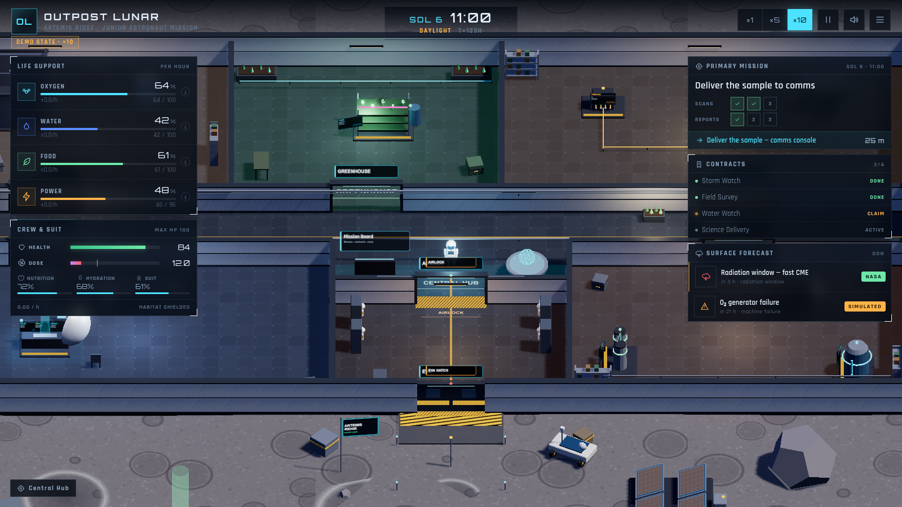

# Outpost Lunar — Junior Astronaut Mission Trainer

A playable **Three.js** adaptation of the design document
[`docs/designs/junior-astronauta-outpost-lunar.md`](docs/designs/junior-astronauta-outpost-lunar.md)
(originally for Godot 4.7, NASA Space Apps Challenge).

A lone astronaut in a five-room lunar base. Four resources, nine machines,
radiation doses in mSv, solar storms driven by archived NASA data, an
Earth–Moon link with real latency, and a scientific mission built around three
reports. Every run ends on an evaluation screen.


| Base and workshop | Communications console |
| --- | --- |
|  |  |

| Final evaluation | Lunar exterior |
| --- | --- |
|  |  |

| Machine inspector | Central hub |
| --- | --- |
|  |  |

## Status

- **Playable end to end** in a desktop browser: title → intro → tutorial → base
  → scanning → reports → evaluation → freeplay.
- **No external requests at runtime.** NASA data is embedded, 3D models are
  served as local build assets, and sources only open if the player clicks a
  link.
- **Automatic local save.** The current run is saved in the browser on every
  tick and when paused, and the title screen offers to continue it. Winning keeps
  the save marked as completed; losing the mission deletes it. Demo presets never
  touch the real save. The report queue and tray crops are persisted too.
- **Science explained in the interface.** Dose is shown in points and in mSv,
  reports wait for the relay pass, and hydroponics grows by trays. A 10-term
  glossary and the simplified-model notes separate real data from the
  adaptation.
- **Two demo presets** to see the whole arc in minutes:
  - *Mid-mission*: one report transmitted, one sample in the backpack, contracts
    ready and a radiation window 3 game hours away.
  - *Final hour*: two reports transmitted, the third sample ready and a final
    radiation window 3 hours away. Sending the last report queues it, and the
    next relay pass, 3 hours later, wins the game.

## Quick start

Requirements: **Node.js 22+** and a desktop browser with WebGL.

```bash
npm install
npm run dev
# open http://127.0.0.1:5173/
```

Production build:

```bash
npm run build
npm run preview
```

The output lands in `dist/`. It is a static site; it can be published on GitHub
Pages, Netlify, a local server, or packaged with Electron/Tauri if a Windows
build is wanted.

## Controls

| Key | Action |
| --- | --- |
| `W A S D` / arrows | Move the astronaut |
| `Shift` (hold) | Sprint while moving |
| `E` | Interact, open a machine, start a scan |
| `1` / `2` / `3` | Clock speed ×1 / ×5 / ×10 |
| `P` | Pause |
| `Esc` | Close panel or open pause |
| `M` | Mute / unmute sound |
| `F1` | Debug overlay (development) |

The pause menu includes a controls list, the glossary and access to the data
sources.

## How to play

### The clock

The game clock is **compressed game time, not real lunar time**. The scale is
fixed: **1 tick = 1 game hour = 60 real seconds at ×1**. The ×5 and ×10
multipliers change the tick rate, never `Engine.time_scale` (it does not apply
here, but the same philosophy holds: the simulation is independent of rendering).

A **mission day** is **24 game hours: 12 of light and 12 of night**. The mission
lasts **300 game hours (12.5 mission days)** or ends earlier if the three reports
are transmitted. A real lunar day lasts **29.53 Earth days**, so the game's
day/night cycle does not reproduce the lunar calendar: it compresses it.

The interface labels each mission day **MISSION DAY** and does not use `SOL` as
a label. The compression note appears next to the clock, in the pause menu and in
the glossary.

**Why the schedule is not real (note for the jury).** The compression is
intentional: with a day of 12 hours of light and 12 of night, children aged 7 to
12 see a complete day, understand the cause-and-effect relationship between what
they do and what changes in the base, and can finish the mission in a single
session. It is not a measurement, a prediction or an operational calendar. The
"in the game / in reality / why" table, with the rest of the compressions, is in
[`docs/DATA-SOURCES.md#política-de-escala`](docs/DATA-SOURCES.md#política-de-escala).

### Resources and life support

- **Oxygen, water, food and power** (bars from 0 to 100).
- The crew consumes O₂, water and food every hour. The **O₂ system** turns water
  and power into air; the **recycler** recovers water; **hydroponics** produces
  O₂ continuously and food only when its trays are harvested.
- Nutrition and hydration are short-term meters: they drop every hour and are
  refilled with rations from the inventory. At zero, health falls.
- If O₂ reaches zero, the **suit reserve (6 hours)** remains, and after that,
  death.
- Power is shared through a **fixed shutdown ladder**:
  lights → hydroponics → recycler → O₂ system. The O₂ system is always the last
  to go down.

### Radiation

Dose **never goes down**. Under a roof it does not rise; outside it rises
according to the solar window (event multiplier) and suit integrity. The 0–100
bar is also presented in millisieverts: **1 point = 2.5 mSv**, so 100 points are
**250 mSv**, the mission dose limit. The thresholds are 30, 70 and 100 points:

- from **30 points (75 mSv)**, maximum health is capped;
- above **70 points (175 mSv)**, the crew takes continuous damage;
- at **100 points (250 mSv)**, the mission ends in a **medical abort due to dose
  limit**, not in a radiation death.

The HUD shows accumulated dose and the instantaneous rate per hour and in mSv/h.
The final evaluation shows the peak dose in both units. The storm shelter, if
closed and you are inside, reduces dose drastically. The conversion and the
educational-model note are in the dose detail and in the glossary.

### Events

Five data-driven archetypes: **machine breakdown**, **production drop**,
**consumption spike**, **radiation window** and **communications outage**.
Radiation windows are based on archived DONKI events; the rest is marked
**SIMULATED**. DSN outages block forecasting and orders, and also **suspend relay
passes**: queued reports are not lost and go out on the first pass after the link
is restored.

### Mission and contracts

- Scan **3 exterior sites** by standing still for 3 seconds. Each site shows its
  state in the world: pending, sample ready, queued or report transmitted; the
  current objective is highlighted and matches the HUD.
- Take the samples to the **communications console** and send **3 reports**.
  The signal takes **1.28 s each way** (**2.56 s** round trip), so the base
  cannot be piloted in real time.
- Sending a report leaves it **queued**: it does not count as sent until it is
  transmitted. Relay passes open every **4 game hours** (at ticks 2, 6, 10…) and
  all queued reports go out together. The console shows the queue and the
  countdown to the next pass.
- Victory comes when the third report is **transmitted**. If the third is queued,
  the run stays in progress until the pass.
- Four optional contracts with fixed conditions; they are claimed at the console.
- On winning or losing, the **evaluation** shows five counters, a timeline and
  what happened to the mission save.

### Saving and resuming

Mission progress is saved in `localStorage` under the key
`outpost-lunar.save.v1`. On returning to the title, the Artemis Ridge card
indicates whether the mission is in progress or completed and offers `CONTINUE
MISSION` or `CONTINUE FREEPLAY`. Starting a new mission with an existing save
asks for confirmation before overwriting it. Winning keeps the completed run;
losing an in-progress mission deletes its save, and a later defeat in freeplay
does not delete an already-won mission. The report queue and tray crops are saved
too: on resuming, the countdown and each crop continue where they were. Saves
from before the change load with the queue and trays empty.

### Machines

O₂ System · Water Recycler · Hydroponics · Solar Array · Battery Bank · Power
Distributor · Repair Bench · Comms Console · Storm Shelter. There are nine
machines; each has two upgrades (the repair bench has three), an energy cost and
an installation time. Every upgrade declares its benefit and its trade-off in the
panel (for example, more O₂ in exchange for more water): it is never a free
decision. The panel shows the numbers and where they come from.

**Hydroponics** works by trays: **3 trays**, a **30 game-hour** cycle and **4**
visible stages. Planting consumes water and power and delivers no food; when
ripe, **manual harvest** yields **10 food**, adjusted by upgrades. The real
reference is a leafy green of about **28 days**: the panel declares that
compression and the expected yield. A ripe crop waits without losing yield, and
growth only advances while the machine is on, healthy and powered. The rest of
the food is rations and emergency deliveries.

### Glossary and terminology

The **glossary** opens from the pause menu and from the tutorial, without leaving
the run, and also from the contextual help of the dose indicator, the hydroponics
panel and the communications console. It gathers 10 terms in simple English —
dose, mSv, microgravity, lunar day, solar particle event (SPE), galactic cosmic
rays (GCR), regolith, EVA, DSN and hydroponics — and each entry defines the
acronyms it uses.

The interface labels mission days **MISSION DAY**. The clock compression note (a
real lunar day lasts 29.53 Earth days) appears in the HUD, in the pause menu and
in the lunar day glossary entry.

## NASA data and honesty

The game explicitly separates:

| Label | Meaning |
| --- | --- |
| **NASA ARCHIVE** | Row anchored to an archived, linked NASA document/event. |
| **SIMULATED** | Game balancing value, not a measurement. |

Main sources (details in [`docs/DATA-SOURCES.md`](docs/DATA-SOURCES.md)):

- **DONKI** — CME 2024-05-08T22:24:00-CME-001 (1130 km/s), SEP
  2024-05-10T14:50:00-SEP-001, CME 2024-05-09T09:24:00-CME-001 and GST
  2024-05-10T15:00:00-GST-001 (Kp 9).
- **LRO CRaTER** — reference lunar dose (~0.197 mGy/day in lunar orbit;
  ~0.318 mGy/day on the surface with LND). The game normalises these rates to a
  0–100 point dose budget for 300 hours and presents each point as **2.5 mSv**,
  with **250 mSv** as the mission limit (NASA-STD-3001); it is an educational
  abstraction, not a clinical model.
- **NASA BVAD** (NASA/TP-2015-218570/REV2) — 0.84 kg O₂, 0.62 kg food solids
  and 2.0 kg drinking water per crew member per day.
- **NASA ECLSS / ISS OGS** — reference for O₂ generation and water and power
  consumption.

The conversion to mSv, the light delay and the crop-cycle compression are
explained in
[`docs/DATA-SOURCES.md`](docs/DATA-SOURCES.md#modelos-con-unidad-real-y-sus-simplificaciones),
separating the archived data from the game simplification.

**Official challenge resources:** the panel separates **Official challenge
resource** (DONKI) from **Additional NASA sources** (LRO CRaTER/LND, NASA BVAD,
ECLSS/ISS OGS) and **Simulated**. The specification and the pending task to show
that split in the panel are in
[`docs/DATA-SOURCES.md#recursos-oficiales-del-challenge-y-fuentes-externas`](docs/DATA-SOURCES.md#recursos-oficiales-del-challenge-y-fuentes-externas).

The game **makes no external network requests at runtime**. GLB models are served
from the build itself and links only open when clicked. It is not an official
NASA product and is not endorsed by NASA.

## Project structure

```text
MindSpace-ThreeJs/
├── docs/
│   ├── designs/junior-astronauta-outpost-lunar.md  # original document
│   ├── ADAPTATION.md      # how the Godot design was translated to Three.js
│   ├── DATA-SOURCES.md    # NASA sources and scale policy
│   ├── PLAYTEST.md        # test checklist
│   └── screenshots/
├── public/                # favicon
├── scripts/
│   ├── audit.mjs          # headless DataAudit
│   ├── balance.mjs        # headless policy simulation
│   ├── smoke.mjs          # Playwright (optional)
│   └── models/
│       └── build_models.py  # generates the GLBs with Blender
├── src/
│   ├── assets/models/     # rover, lander and astronaut (GLB)
│   ├── core/
│   │   ├── sim.js         # GameSim: deterministic tick
│   │   ├── event-log.js   # append-only ledger
│   │   ├── evaluation.js  # counters, grade and timeline
│   │   ├── audit.js       # data validation
│   │   └── audio.js       # 5 synthesised SFX + wind
│   ├── data/              # economy, machines, events, contracts, POIs,
│   │                      # strings, sources, glossary and presets
│   ├── world/             # scene, base, exterior, astronaut, 3D models
│   ├── ui/                # HUD, panels, console, glossary, screens,
│   │                      # debug and CSS
│   └── main.js            # state machine and loop
├── tests/                 # sim, data and evaluation (node:test)
├── index.html
├── package.json
└── vite.config.js
```

The glossary content lives in `src/data/glossary.js` and its modal in
`src/ui/glossary.js`.

## Development and validation

```bash
npm run audit     # validates ids, ranges, references and provenance
npm test          # simulation, data, save and evaluation suite
npm run build     # Vite build
npm run check     # audit + tests + build
```

### 3D models

The rover, the lander and the astronaut are self-authored GLBs, modelled with
Blender. They are generated reproducibly (units in metres, low-poly, no external
textures):

```bash
npm run models    # requires Blender on the PATH; takes a few seconds
```

The `scripts/models/build_models.py` script rebuilds
`src/assets/models/*.glb` and leaves previews in `/tmp/opencode`. The game loads
all three at startup; if any is missing or corrupt, it falls back to procedural
geometry and keeps playing. The machines and the rest of the props remain
procedural.

**DataAudit** also runs at startup in development and appears in the `F1`
overlay. It validates:

- unique ids for machines, events, contracts and POIs;
- existing references (targets, events, sources);
- resource and effect ranges;
- `real_data` sources with URL and ISO date;
- preset invariants: they are loaded and simulated for 4 ticks to reject states
  that are born in a death cascade.

### Playwright smoke test (optional)

```bash
npx playwright install chromium
PLAYWRIGHT_CHROMIUM=/path/to/chrome node scripts/smoke.mjs
```

The script opens the game, walks through title, intro, tutorial and a run,
captures the key screens and checks that there are no page errors. On this
machine the already-cached Chromium was used; the environment variable is
optional.

## Documentation

- **Original design**: [`docs/designs/junior-astronauta-outpost-lunar.md`](docs/designs/junior-astronauta-outpost-lunar.md)
- **Adaptation**: [`docs/ADAPTATION.md`](docs/ADAPTATION.md)
- **Data**: [`docs/DATA-SOURCES.md`](docs/DATA-SOURCES.md)
- **Testing**: [`docs/PLAYTEST.md`](docs/PLAYTEST.md)
- **Evaluator guide**: [`EVALUATORS.md`](EVALUATORS.md)

## Credits

- Code and original content of this adaptation: the **MindSpace / Outpost
  Lunar** project.
- Engine: [Three.js](https://threejs.org/).
- Build: [Vite](https://vite.dev/).
- 3D models (rover, lander, astronaut): self-authored, generated with
  [Blender](https://www.blender.org/) from `scripts/models/build_models.py`.
- Self-hosted fonts: [Fontsource](https://fontsource.org/) (Orbitron, Rajdhani),
  SIL OFL licences.
- Data: NASA CCMC DONKI, LRO CRaTER, NASA BVAD/ECLSS. Links and dates in the
  game's own **Data Sources** panel.

> Independent educational game inspired by the *Junior Astronaut Mission
> Trainer* challenge from NASA Space Apps. It is not an official NASA product.
