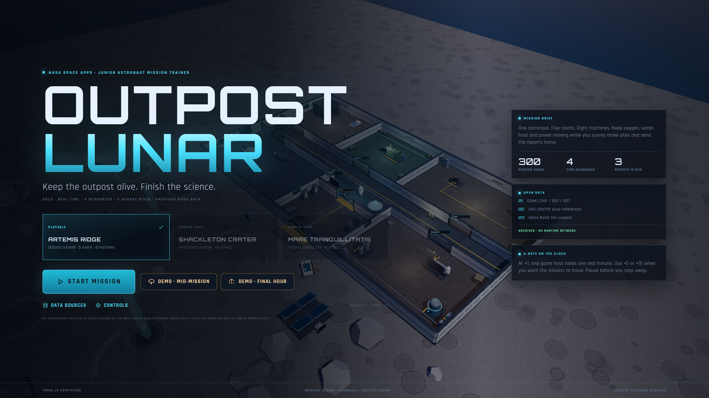
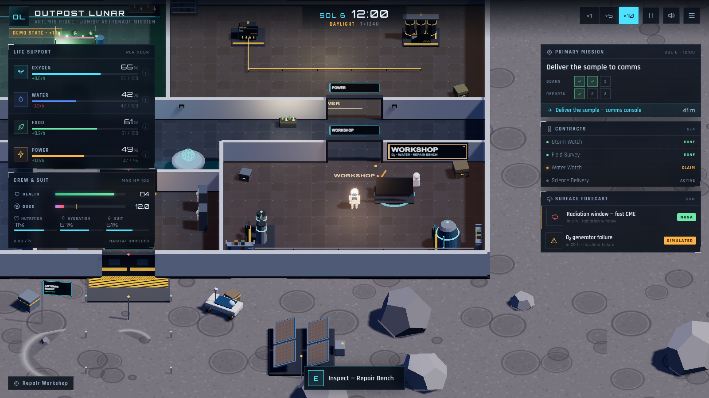
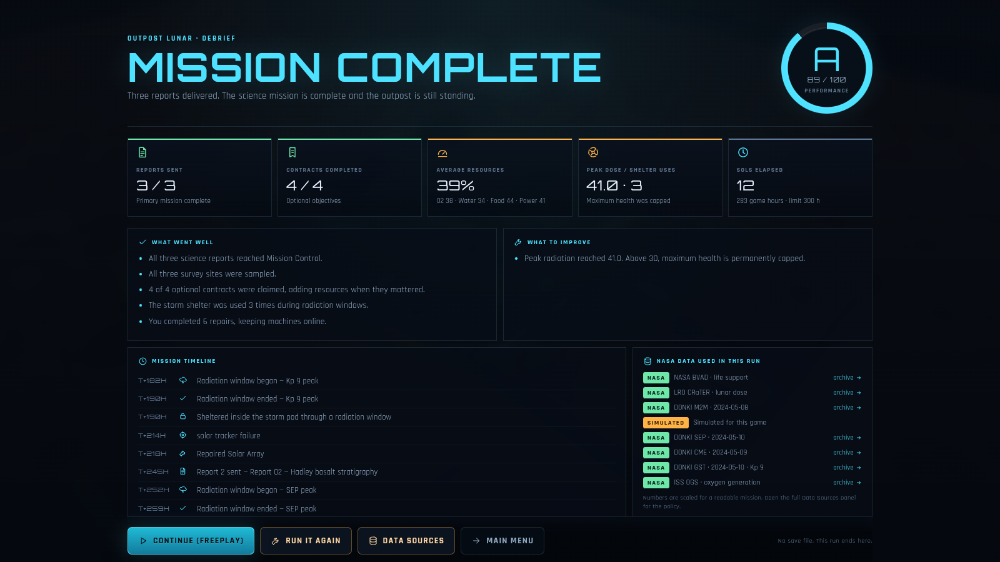

# Outpost Lunar — Junior Astronaut Mission Trainer

Adaptación jugable en **Three.js** del documento de diseño
[`docs/designs/junior-astronauta-outpost-lunar.md`](docs/designs/junior-astronauta-outpost-lunar.md)
(original para Godot 4.7, NASA Space Apps Challenge).

Una astronauta sola en una base lunar de cinco salas. Cuatro recursos, nueve
máquinas, dosis de radiación en mSv, tormentas solares con datos NASA
archivados, un enlace Tierra–Luna con retardo real y una misión científica de
tres informes. Toda partida termina en una pantalla de evaluación.



| Base y taller | Consola de comunicaciones |
| --- | --- |
|  |  |

| Evaluación final | Exterior lunar |
| --- | --- |
|  |  |

| Inspector de máquina | Hub central |
| --- | --- |
|  |  |

## Estado

- **Jugable de principio a fin** en navegador de escritorio: título → intro →
  tutorial → base → escaneo → informes → evaluación → freeplay.
- **Sin peticiones externas en runtime.** Los datos NASA están embebidos, los
  modelos 3D se sirven como assets locales del build y las fuentes solo se abren
  si el jugador hace clic en un enlace.
- **Guardado local automático.** La partida en curso se guarda en el navegador
  en cada tick y al pausar, y el título ofrece continuarla. Ganar conserva el
  guardado marcado como completado; perder la misión lo elimina. Los presets de
  demo no tocan el guardado real. La cola de informes y los cultivos de las
  bandejas también se persisten.
- **Ciencia explicada en la interfaz.** La dosis se muestra en puntos y en mSv,
  los informes esperan al pase de relay y la hidroponía crece por bandejas. Un
  glosario de 10 términos y las notas de modelo simplificado separan el dato
  real de la adaptación.
- **Dos presets de demo** para ver el arco completo en minutos:
  - *Mid-mission*: un informe transmitido, una muestra en la mochila, contratos
    listos y una ventana de radiación a 3 horas de juego.
  - *Final hour*: dos informes transmitidos, la tercera muestra lista y una
    ventana de radiación final a 3 horas. Enviar el último informe lo encola y
    el siguiente pase de relay, 3 horas después, gana la partida.

## Arranque rápido

Requisitos: **Node.js 22+** y un navegador de escritorio con WebGL.

```bash
npm install
npm run dev
# abre http://127.0.0.1:5173/
```

Build de producción:

```bash
npm run build
npm run preview
```

El resultado queda en `dist/`. Es una web estática; se puede publicar en GitHub
Pages, Netlify, un servidor local o empaquetar con Electron/Tauri si se quiere
una build de Windows.

## Controles

| Tecla | Acción |
| --- | --- |
| `W A S D` / flechas | Mover a la astronauta |
| `Shift` (mantener) | Sprint mientras se mueve |
| `E` | Interactuar, abrir una máquina, empezar un escaneo |
| `1` / `2` / `3` | Velocidad del reloj ×1 / ×5 / ×10 |
| `P` | Pausa |
| `Esc` | Cerrar panel o abrir pausa |
| `M` | Silenciar / activar sonido |
| `F1` | Overlay de debug (desarrollo) |

En pausa hay una lista de controles, el glosario y acceso a las fuentes de datos.

## Cómo se juega

### El reloj

El reloj del juego es **tiempo de juego comprimido, no tiempo lunar real**. La
escala es fija: **1 tick = 1 hora de juego = 60 segundos reales a ×1**. Los
multiplicadores ×5 y ×10 cambian la tasa del tick, nunca `Engine.time_scale`
(no aplica aquí, pero se mantiene la misma filosofía: la simulación es
independiente del render).

Un **día de misión** son **24 horas de juego: 12 de luz y 12 de noche**. La
misión dura **300 horas de juego (12,5 días de misión)** o termina antes si se
transmiten los tres informes. Un día lunar real dura **29,53 días terrestres**,
así que el ciclo día/noche del juego no reproduce el calendario lunar: lo
comprime.

La interfaz llama **MISSION DAY** a cada día de misión y no usa `SOL` como
etiqueta. La nota de compresión aparece junto al reloj, en la pausa y en el
glosario.

**Por qué el horario no es real (nota para el jurado).** La compresión es
intencionada: con un día de 12 horas de luz y 12 de noche, los niños de 7 a 12
años ven un día completo, entienden la relación causa-efecto entre lo que hacen
y lo que cambia en la base, y pueden terminar la misión en una sola sesión. No
es una medida, una predicción ni un calendario operativo. La tabla «en el juego /
en la realidad / por qué», con el resto de compresiones, está en
[`docs/DATA-SOURCES.md#política-de-escala`](docs/DATA-SOURCES.md#política-de-escala).

### Recursos y soporte vital

- **Oxígeno, agua, comida y energía** (barras de 0 a 100).
- La tripulación consume O₂, agua y comida cada hora. El **sistema de O₂**
  convierte agua y energía en aire; el **reciclador** recupera agua; la
  **hidroponía** produce O₂ de forma continua y comida solo al cosechar sus
  bandejas.
- Nutrición e hidratación son medidores a corto plazo: bajan cada hora y se
  recargan con raciones del inventario. A cero, la salud cae.
- Si el O₂ llega a cero, queda la **reserva del traje (6 horas)** y después la
  muerte.
- La energía se reparte con una **escalera de apagado fija**:
  luces → hidroponía → reciclador → sistema de O₂. El sistema de O₂ es siempre
  el último en caer.

### Radiación

La dosis **nunca baja**. Bajo techo no sube; en el exterior sube según la
ventana solar (multiplicador del evento) y la integridad del traje. La barra de
0 a 100 se presenta también en milisieverts: **1 punto = 2,5 mSv**, así que 100
puntos son **250 mSv**, el límite de dosis de la misión. Los umbrales son 30,
70 y 100 puntos:

- a partir de **30 puntos (75 mSv)**, la salud máxima queda limitada;
- por encima de **70 puntos (175 mSv)**, la tripulación recibe daño continuo;
- a **100 puntos (250 mSv)**, la misión termina en **aborto médico por límite de
  dosis**, no en una muerte por radiación.

El HUD muestra la dosis acumulada y la tasa instantánea por hora y en mSv/h. La
evaluación final muestra el pico de dosis en ambas unidades. El refugio de
tormenta, si está cerrado y estás dentro, reduce la dosis drásticamente. La
conversión y la nota de modelo educativo están en el detalle de dosis y en el
glosario.

### Eventos

Cinco arquetipos data-driven: **avería de máquina**, **caída de producción**,
**pico de consumo**, **ventana de radiación** y **corte de comunicaciones**.
Las ventanas de radiación se basan en eventos DONKI archivados; el resto está
marcado como **SIMULATED**. Los cortes de DSN bloquean previsión y pedidos, y
además **suspenden los pases de relay**: los informes en cola no se pierden y
salen en el primer pase tras restablecerse el enlace.

### Misión y contratos

- Escanea **3 sitios** exteriores manteniéndote quieta durante 3 segundos. Cada
  sitio muestra su estado en el mundo: pendiente, muestra lista, en cola o
  informe transmitido; el objetivo actual se resalta y coincide con el HUD.
- Lleva las muestras a la **consola de comunicaciones** y envía **3 informes**.
  La señal tarda **1,28 s en cada sentido** (**2,56 s** ida y vuelta), así que la
  base no se pilota en tiempo real.
- Enviar un informe lo deja **en cola**: no cuenta como enviado hasta que se
  transmite. Los pases de relay se abren cada **4 horas de juego** (en los ticks
  2, 6, 10…) y todos los informes en cola salen juntos. La consola muestra la
  cola y la cuenta atrás hasta el siguiente pase.
- La victoria llega cuando se **transmite** el tercer informe. Si el tercero
  está en cola, la partida sigue en curso hasta el pase.
- Cuatro contratos opcionales con condiciones fijas; se reclaman en la consola.
- Al ganar o perder, la **evaluación** muestra cinco contadores, una línea de
  tiempo y qué pasó con el guardado de la misión.

### Guardado y reanudación

El progreso de la misión se guarda en `localStorage` con la clave
`outpost-lunar.save.v1`. Al volver al título, la tarjeta de Artemis Ridge indica
si la misión está en curso o completada y ofrece `CONTINUE MISSION` o
`CONTINUE FREEPLAY`. Empezar una misión nueva con un guardado existente pide
confirmación antes de sobrescribirlo. Ganar conserva la partida completada;
perder una misión en curso borra su guardado, y una derrota posterior en
freeplay no borra una misión ya ganada. La cola de informes y los cultivos de las
bandejas también se guardan: al reanudar, la cuenta atrás y cada cultivo siguen
donde estaban. Los guardados anteriores al cambio cargan con la cola y las
bandejas vacías.

### Máquinas

O₂ System · Water Recycler · Hydroponics · Solar Array · Battery Bank · Power
Distributor · Repair Bench · Comms Console · Storm Shelter. Son nueve máquinas;
cada una tiene dos mejoras (el banco de reparación tiene tres), coste en energía
y tiempo de instalación. Toda mejora declara en el panel su beneficio y su
contrapartida (por ejemplo, más O₂ a cambio de más agua): nunca es una decisión
gratis. El panel muestra los números y su procedencia.

La **hidroponía** funciona por bandejas: **3 bandejas**, un ciclo de **30 horas
de juego** y **4 etapas** visibles. Plantar consume agua y energía y no entrega
comida; al madurar, la **cosecha manual** rinde **10 de comida**, ajustados por
las mejoras. La referencia real es una hoja verde de unos **28 días**: el panel
declara esa compresión y el rendimiento esperado. Un cultivo maduro espera sin
perder rendimiento, y el crecimiento solo avanza con la máquina encendida, sana
y con energía. El resto de la comida son raciones y entregas de emergencia.

### Glosario y terminología

El **glosario** se abre desde la pausa y desde el tutorial, sin abandonar la
partida, y también desde la ayuda contextual del indicador de dosis, el panel de
hidroponía y la consola de comunicaciones. Reúne 10 términos en inglés sencillo
—dosis, mSv, microgravedad, día lunar, evento de partículas solares (SPE), rayos
cósmicos galácticos (GCR), regolito, EVA, DSN e hidroponía— y cada entrada
define los acrónimos que usa.

La interfaz llama **MISSION DAY** a los días de misión. La nota de compresión del
reloj (un día lunar real dura 29,53 días terrestres) aparece en el HUD, en la
pausa y en la entrada de día lunar del glosario.

## Datos NASA y honestidad

El juego separa explícitamente:

| Etiqueta | Significado |
| --- | --- |
| **NASA ARCHIVE** | Fila anclada a un documento/evento NASA archivado y enlazado. |
| **SIMULATED** | Valor de equilibrado del juego, no una medida. |

Fuentes principales (detalle en [`docs/DATA-SOURCES.md`](docs/DATA-SOURCES.md)):

- **DONKI** — CME 2024-05-08T22:24:00-CME-001 (1130 km/s), SEP
  2024-05-10T14:50:00-SEP-001, CME 2024-05-09T09:24:00-CME-001 y GST
  2024-05-10T15:00:00-GST-001 (Kp 9).
- **LRO CRaTER** — dosis lunar de referencia (~0,197 mGy/día en órbita lunar;
  ~0,318 mGy/día en superficie con LND). El juego normaliza estas tasas a un
  presupuesto de dosis de 0–100 puntos para 300 horas y presenta cada punto como
  **2,5 mSv**, con **250 mSv** como límite de misión (NASA-STD-3001); es una
  abstracción educativa, no un modelo clínico.
- **NASA BVAD** (NASA/TP-2015-218570/REV2) — 0,84 kg O₂, 0,62 kg de sólidos de
  comida y 2,0 kg de agua potable por tripulante y día.
- **NASA ECLSS / ISS OGS** — referencia de generación de O₂ y consumo de agua y
  potencia.

La conversión a mSv, el retardo de la luz y la compresión del ciclo de cultivo
se explican en [`docs/DATA-SOURCES.md`](docs/DATA-SOURCES.md#modelos-con-unidad-real-y-sus-simplificaciones),
separando el dato archivado de la simplificación del juego.

**Recursos oficiales del challenge:** el panel separa **Official challenge
resource** (DONKI) de **Additional NASA sources** (LRO CRaTER/LND, NASA BVAD,
ECLSS/ISS OGS) y **Simulated**. La especificación y la tarea pendiente para
mostrar esa división en el panel están en
[`docs/DATA-SOURCES.md#recursos-oficiales-del-challenge-y-fuentes-externas`](docs/DATA-SOURCES.md#recursos-oficiales-del-challenge-y-fuentes-externas).

El juego **no hace peticiones de red externas en runtime**. Los modelos GLB se
sirven desde el propio build y los enlaces se abren solo al hacer clic. No es un
producto oficial de NASA ni está avalado por NASA.

## Estructura del proyecto

```text
MindSpace-ThreeJs/
├── docs/
│   ├── designs/junior-astronauta-outpost-lunar.md  # documento original
│   ├── ADAPTATION.md      # cómo se tradujo el diseño Godot a Three.js
│   ├── DATA-SOURCES.md    # fuentes NASA y política de escala
│   ├── PLAYTEST.md        # checklist de pruebas
│   └── screenshots/
├── public/                # favicon
├── scripts/
│   ├── audit.mjs          # DataAudit headless
│   ├── balance.mjs        # simulación headless de políticas
│   ├── smoke.mjs          # Playwright (opcional)
│   └── models/
│       └── build_models.py  # genera los GLB con Blender
├── src/
│   ├── assets/models/     # rover, lander y astronauta (GLB)
│   ├── core/
│   │   ├── sim.js         # GameSim: tick determinista
│   │   ├── event-log.js   # ledger append-only
│   │   ├── evaluation.js  # contadores, nota y timeline
│   │   ├── audit.js       # validación de datos
│   │   └── audio.js       # 5 SFX sintetizados + viento
│   ├── data/              # economía, máquinas, eventos, contratos, POIs,
│   │                      # strings, fuentes, glosario y presets
│   ├── world/             # escena, base, exterior, astronauta, modelos 3D
│   ├── ui/                # HUD, paneles, consola, glosario, pantallas,
│   │                      # debug y CSS
│   └── main.js            # máquina de estados y bucle
├── tests/                 # sim, datos y evaluación (node:test)
├── index.html
├── package.json
└── vite.config.js
```

El contenido del glosario vive en `src/data/glossary.js` y su modal en
`src/ui/glossary.js`.

## Desarrollo y validación

```bash
npm run audit     # valida ids, rangos, referencias y procedencia
npm test          # suite de simulación, datos, guardado y evaluación
npm run build     # build de Vite
npm run check     # audit + tests + build
```

### Modelos 3D

El rover, el lander y la astronauta son GLB de autoría propia, modelados con
Blender. Se generan de forma reproducible (unidades en metros, low-poly, sin
texturas externas):

```bash
npm run models    # requiere Blender en el PATH; tarda unos segundos
```

El script `scripts/models/build_models.py` reconstruye
`src/assets/models/*.glb` y deja previews en `/tmp/opencode`. El juego carga los
tres al arrancar; si alguno falta o está corrupto, usa la geometría procedural
de respaldo y sigue jugando. Las máquinas y el resto de props continúan siendo
procedurales.

El **DataAudit** corre también al arrancar en desarrollo y aparece en el overlay
`F1`. Valida:

- ids únicos de máquinas, eventos, contratos y POIs;
- referencias existentes (targets, eventos, fuentes);
- rangos de recursos y efectos;
- fuentes `real_data` con URL y fecha ISO;
- invariantes de los presets: se cargan y se simulan 4 ticks para rechazar
  estados que nazcan en cascada de muerte.

### Smoke test con Playwright (opcional)

```bash
npx playwright install chromium
PLAYWRIGHT_CHROMIUM=/ruta/a/chrome node scripts/smoke.mjs
```

El script abre el juego, recorre título, intro, tutorial y partida, captura las
pantallas clave y comprueba que no hay errores de página. En esta máquina se usó
el Chromium ya cacheado; la variable de entorno es opcional.

## Documentación

- **Diseño original**: [`docs/designs/junior-astronauta-outpost-lunar.md`](docs/designs/junior-astronauta-outpost-lunar.md)
- **Adaptación**: [`docs/ADAPTATION.md`](docs/ADAPTATION.md)
- **Datos**: [`docs/DATA-SOURCES.md`](docs/DATA-SOURCES.md)
- **Pruebas**: [`docs/PLAYTEST.md`](docs/PLAYTEST.md)

## Créditos

- Código y contenido original de esta adaptación: proyecto **MindSpace /
  Outpost Lunar**.
- Motor: [Three.js](https://threejs.org/).
- Build: [Vite](https://vite.dev/).
- Modelos 3D (rover, lander, astronauta): autoría propia, generados con
  [Blender](https://www.blender.org/) desde `scripts/models/build_models.py`.
- Tipografías autohospedadas: [Fontsource](https://fontsource.org/)
  (Orbitron, Rajdhani), licencias SIL OFL.
- Datos: NASA CCMC DONKI, LRO CRaTeR, NASA BVAD/ECLSS. Enlaces y fechas en el
  panel **Data Sources** del propio juego.

> Juego educativo independiente inspirado en el desafío *Junior Astronaut
> Mission Trainer* de NASA Space Apps. No es un producto oficial de NASA.
