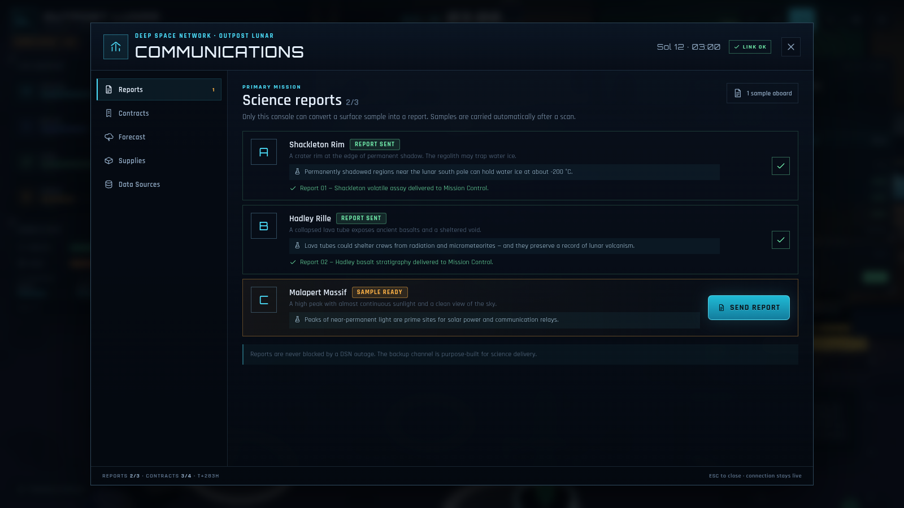
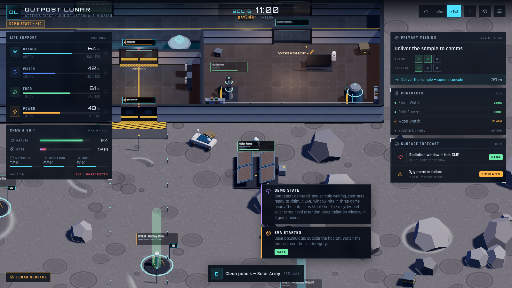
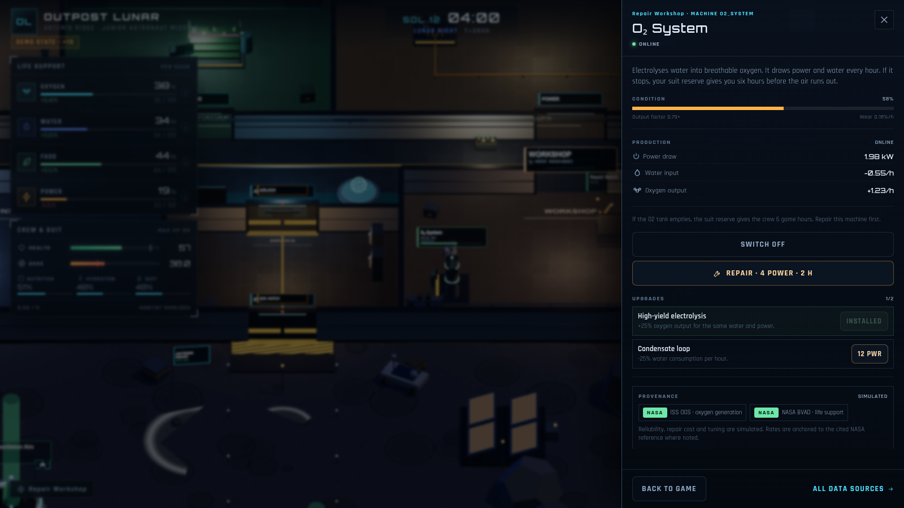

# Outpost Lunar — Junior Astronaut Mission Trainer

Adaptación jugable en **Three.js** del documento de diseño
[`docs/designs/junior-astronauta-outpost-lunar.md`](docs/designs/junior-astronauta-outpost-lunar.md)
(original para Godot 4.7, NASA Space Apps Challenge).

Una astronauta sola en una base lunar de cinco salas. Cuatro recursos, ocho
máquinas, radiación acumulada, tormentas solares con datos NASA archivados y una
misión científica de tres informes. Toda partida termina en una pantalla de
evaluación.


| Base y taller | Consola de comunicaciones |
| --- | --- |
|  |  |

| Evaluación final | Exterior lunar |
| --- | --- |
|  |  |

| Inspector de máquina | Hub central |
| --- | --- |
|  |  |

## Estado

- **Jugable de principio a fin** en navegador de escritorio: título → intro →
  tutorial → base → escaneo → informes → evaluación → freeplay.
- **Sin servidor, sin HTTP en runtime.** Los datos NASA están embebidos y las
  fuentes solo se abren si el jugador hace clic en un enlace.
- **Sin guardado.** Recargar la página empieza una partida nueva, como pide el
  diseño original.
- **Dos presets de demo** para ver el arco completo en minutos:
  - *Mid-mission*: un informe entregado, una muestra en la mochila, contratos
    listos y una ventana de radiación a 3 horas de juego.
  - *Final hour*: dos informes entregados, la tercera muestra lista y una
    ventana de radiación final a 3 horas. Enviar el último informe gana la
    partida.

## Arranque rápido

Requisitos: **Node.js 22+** y un navegador de escritorio con WebGL.

```bash
npm install
npm run dev
# abre http://127.0.0.1:5173/
```

Build de producción:

```bash
npm run build
npm run preview
```

El resultado queda en `dist/`. Es una web estática; se puede publicar en GitHub
Pages, Netlify, un servidor local o empaquetar con Electron/Tauri si se quiere
una build de Windows.

## Controles

| Tecla | Acción |
| --- | --- |
| `W A S D` / flechas | Mover a la astronauta |
| `E` | Interactuar, abrir una máquina, empezar un escaneo |
| `1` / `2` / `3` | Velocidad del reloj ×1 / ×5 / ×10 |
| `P` | Pausa |
| `Esc` | Cerrar panel o abrir pausa |
| `M` | Silenciar / activar sonido |
| `F1` | Overlay de debug (desarrollo) |

En pausa hay una lista de controles y acceso a las fuentes de datos.

## Cómo se juega

### El reloj

Un **tick = 1 hora de juego = 60 segundos reales a ×1**. Los multiplicadores
×5 y ×10 cambian la tasa del tick, nunca `Engine.time_scale` (no aplica aquí,
pero se mantiene la misma filosofía: la simulación es independiente del render).
La misión dura **300 ticks** (12,5 soles) o termina antes si envías los tres
informes.

### Recursos y soporte vital

- **Oxígeno, agua, comida y energía** (barras de 0 a 100).
- La tripulación consume O₂, agua y comida cada hora. El **sistema de O₂**
  convierte agua y energía en aire; el **reciclador** recupera agua; la
  **hidroponía** produce comida y un poco de O₂.
- Nutrición e hidratación son medidores a corto plazo: bajan cada hora y se
  recargan con raciones del inventario. A cero, la salud cae.
- Si el O₂ llega a cero, queda la **reserva del traje (6 horas)** y después la
  muerte.
- La energía se reparte con una **escalera de apagado fija**:
  luces → hidroponía → reciclador → sistema de O₂. El sistema de O₂ es siempre
  el último en caer.

### Radiación

La dosis **nunca baja**. Bajo techo no sube; en el exterior sube según la
ventana solar (multiplicador del evento) y la integridad del traje. Por encima
de 30 puntos, la salud máxima queda limitada; a 100, muerte. El refugio de
tormenta, si está cerrado y estás dentro, reduce la dosis drásticamente.

### Eventos

Cinco arquetipos data-driven: **avería de máquina**, **caída de producción**,
**pico de consumo**, **ventana de radiación** y **corte de comunicaciones**.
Las ventanas de radiación se basan en eventos DONKI archivados; el resto está
marcado como **SIMULATED**. Los cortes de DSN bloquean previsión y pedidos,
pero **nunca el envío de informes**.

### Misión y contratos

- Escanea **3 sitios** exteriores manteniéndote quieta durante 3 segundos.
- Lleva las muestras a la **consola de comunicaciones** y envía **3 informes**.
- Cuatro contratos opcionales con condiciones fijas; se reclaman en la consola.
- Al ganar o perder, la **evaluación** muestra cinco contadores y una línea de
  tiempo con lo que pasó.

### Máquinas

O₂ System · Water Recycler · Hydroponics · Solar Array · Battery Bank · Power
Distributor · Repair Bench · Comms Console · Storm Shelter. Cada una tiene dos
mejoras (el banco de reparación tiene tres), coste en energía y tiempo de
instalación. Toda mejora declara en el panel su beneficio y su contrapartida
(por ejemplo, más O₂ a cambio de más agua): nunca es una decisión gratis. El
panel muestra los números y su procedencia.

## Datos NASA y honestidad

El juego separa explícitamente:

| Etiqueta | Significado |
| --- | --- |
| **NASA ARCHIVE** | Fila anclada a un documento/evento NASA archivado y enlazado. |
| **SIMULATED** | Valor de equilibrado del juego, no una medida. |

Fuentes principales (detalle en [`docs/DATA-SOURCES.md`](docs/DATA-SOURCES.md)):

- **DONKI** — CME 2024-05-08T22:24:00-CME-001 (1130 km/s), SEP
  2024-05-10T14:50:00-SEP-001, CME 2024-05-09T09:24:00-CME-001 y GST
  2024-05-10T15:00:00-GST-001 (Kp 9).
- **LRO CRaTER** — dosis lunar de referencia (~0,197 mGy/día en órbita lunar;
  ~0,318 mGy/día en superficie con LND). El juego normaliza estas tasas a un
  presupuesto de dosis de 0-100 para 300 horas; es una abstracción educativa,
  no un modelo clínico.
- **NASA BVAD** (NASA/TP-2015-218570/REV2) — 0,84 kg O₂, 0,62 kg de sólidos de
  comida y 2,0 kg de agua potable por tripulante y día.
- **NASA ECLSS / ISS OGS** — referencia de generación de O₂ y consumo de agua y
  potencia.

**Recursos oficiales del challenge:** el panel separa **Official challenge
resource** (DONKI) de **Additional NASA sources** (LRO CRaTER/LND, NASA BVAD,
ECLSS/ISS OGS) y **Simulated**. La especificación y la tarea pendiente para
mostrar esa división en el panel están en
[`docs/DATA-SOURCES.md#recursos-oficiales-del-challenge-y-fuentes-externas`](docs/DATA-SOURCES.md#recursos-oficiales-del-challenge-y-fuentes-externas).

El juego **no hace peticiones de red en runtime**. Los enlaces se abren solo al
hacer clic. No es un producto oficial de NASA ni está avalado por NASA.

## Estructura del proyecto

```text
MindSpace-ThreeJs/
├── docs/
│   ├── designs/junior-astronauta-outpost-lunar.md  # documento original
│   ├── ADAPTATION.md      # cómo se tradujo el diseño Godot a Three.js
│   ├── DATA-SOURCES.md    # fuentes NASA y política de escala
│   ├── PLAYTEST.md        # checklist de pruebas
│   └── screenshots/
├── public/                # favicon
├── scripts/
│   ├── audit.mjs          # DataAudit headless
│   ├── balance.mjs        # simulación headless de políticas
│   └── smoke.mjs          # Playwright (opcional)
├── src/
│   ├── core/
│   │   ├── sim.js         # GameSim: tick determinista
│   │   ├── event-log.js   # ledger append-only
│   │   ├── evaluation.js  # contadores, nota y timeline
│   │   ├── audit.js       # validación de datos
│   │   └── audio.js       # 5 SFX sintetizados + viento
│   ├── data/              # economía, máquinas, eventos, contratos, POIs,
│   │   │                  # strings, fuentes y presets
│   ├── world/             # escena, base, exterior, astronauta, modelos 3D
│   ├── ui/                # HUD, paneles, consola, pantallas, debug, CSS
│   └── main.js            # máquina de estados y bucle
├── tests/                 # sim, datos y evaluación (node:test)
├── index.html
├── package.json
└── vite.config.js
```

## Desarrollo y validación

```bash
npm run audit     # valida ids, rangos, referencias y procedencia
npm test          # 34 tests de simulación, datos y evaluación
npm run build     # build de Vite
npm run check     # audit + tests + build
```

El **DataAudit** corre también al arrancar en desarrollo y aparece en el overlay
`F1`. Valida:

- ids únicos de máquinas, eventos, contratos y POIs;
- referencias existentes (targets, eventos, fuentes);
- rangos de recursos y efectos;
- fuentes `real_data` con URL y fecha ISO;
- invariantes de los presets: se cargan y se simulan 4 ticks para rechazar
  estados que nazcan en cascada de muerte.

### Smoke test con Playwright (opcional)

```bash
npx playwright install chromium
PLAYWRIGHT_CHROMIUM=/ruta/a/chrome node scripts/smoke.mjs
```

El script abre el juego, recorre título, intro, tutorial y partida, captura las
pantallas clave y comprueba que no hay errores de página. En esta máquina se usó
el Chromium ya cacheado; la variable de entorno es opcional.

## Documentación

- **Diseño original**: [`docs/designs/junior-astronauta-outpost-lunar.md`](docs/designs/junior-astronauta-outpost-lunar.md)
- **Adaptación**: [`docs/ADAPTATION.md`](docs/ADAPTATION.md)
- **Datos**: [`docs/DATA-SOURCES.md`](docs/DATA-SOURCES.md)
- **Pruebas**: [`docs/PLAYTEST.md`](docs/PLAYTEST.md)

## Créditos

- Código y contenido original de esta adaptación: proyecto **MindSpace /
  Outpost Lunar**.
- Motor: [Three.js](https://threejs.org/).
- Build: [Vite](https://vite.dev/).
- Tipografías autohospedadas: [Fontsource](https://fontsource.org/)
  (Orbitron, Rajdhani), licencias SIL OFL.
- Datos: NASA CCMC DONKI, LRO CRaTeR, NASA BVAD/ECLSS. Enlaces y fechas en el
  panel **Data Sources** del propio juego.

> Juego educativo independiente inspirado en el desafío *Junior Astronaut
> Mission Trainer* de NASA Space Apps. No es un producto oficial de NASA.
