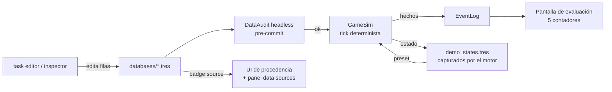

# Junior Astronaut Mission Trainer — Outpost Lunar

- **Autor:** DevGreem
- **Estado:** Proposed
- **Fecha:** 2026-11-14

---

## Resumen

Juego **Godot 4.7 singleplayer** para el NASA Space Apps Challenge 2026 (desafío "Build a Junior Astronaut Mission Trainer"), construido en ~36 horas por tres personas (un programador fuerte, un programador novel haciendo UI, un ayudante). El jugador controla en tiempo real a un astronauta en una base lunar fija de 5 salas (dormitorio-almacén, invernadero, energía con panel solar, taller de reparación, comunicaciones). Mantiene cuatro recursos (**oxígeno, agua, comida, energía**) reparando y mejorando 8 máquinas, gestiona su **radiación acumulada** (los interiores limitan la dosis; el exterior conlleva dosis según distancia), sobrevive **eventos lunares data-driven** con **procedencia NASA visible** (DONKI/dosis RAD/NTRS, etiquetados "archived" o "simulated"), y cumple una **misión principal de exploración científica** (escaneo de 3 puntos de interés → 3 informes enviados desde comunicaciones). Toda partida termina en una **pantalla de evaluación** de lo que se hizo bien o mal, gane o pierda. Orientado a estudiantes jóvenes; la Luna es el único planeta en esta edición.

## El Problema

El brief del desafío lo enuncia directamente: el contenido STEM espacial o simplifica los trade-offs de ingeniería hasta vaciarlos, o los presenta a un nivel que un estudiante no sostiene. El juego debe hacer **tangibles** los intercambios que salvan o matan una misión (soporte vital, blindaje contra radiación, energía, comida) y mostrar **qué dato NASA origina cada número en pantalla** (no existe dataset NASA con cifras de soporte vital: se citan informes NTRS; los feeds reales son DONKI para tormentas solares y dosis RAD para radiación).

Restricciones que definen todo el diseño:

1. **~36 horas de construcción** con una persona de lógica (también la del arte-Aseprite), una de UI aprendiendo Godot y un ayudante. El alcance del brief inicial estaba sobredimensionado ~2–3× y se recortó en dos pasadas de revisión paralela (ver `.egm/concepts_brief.md` y `.egm/reports/`).
2. **El juez mira minutos, la partida dura horas.** El loop de misión (~5 h reales, 300 ticks de 1 h de juego) no cabe en una demo. El motor debe permitir ver el arco completo en 2–5 minutos sin contenido de demo improvisado.
3. **El dato NASA es criterio juzgado, no decoración.** Los números de prueba son legítimos durante el desarrollo, pero la visibilidad de fuente acompaña a cada fila desde la hora 1 y los valores reales verificados entran antes del golden build; lo no verificado se etiqueta honestamente como simulado.
4. **Tres manos sobre un mismo repo en una rama** con formatos frágiles (escenas `.tscn`, Resources `.tres` con `uid://`). Sin guardarraíles de proceso, un conflicto o un uid duplicado puede costar horas a mitad del evento.

## Metas

1. **Build jugable exportado (Windows + HTML5)** que arranca sin `ERROR` ni `SCRIPT ERROR` en el smoke test de H8 y en el golden build de H28.
2. **Loop completo demo-able en minutos:** crear partida → diálogos de Mission Control (tutorial) → mantener recursos → evento DONKI con fuente visible → contramedida (refugio/limpieza/reparación) → enviar informe → evaluación final. Los presets de demo-jump (capturados por el motor, con validador de invariantes) muestran mitad de partida y hora final justo antes de una ventana de radiación.
3. **Procedencia visible en cada número:** cada fila de datos lleva `source`, `source_url`, `date_archived`, `archived` y `real_data`; la UI de "fuente" y el panel "data sources" de la consola de comunicaciones los renderizan. `real_data: false` se muestra como badge "simulated"; nada se mide con datos inventados disfrazados de reales.
4. **Trade-offs perceptibles, no barras inertes:** cada cara de una decisión toca un número visible. Energía repartida entre sistemas con orden de apagado fijo; salir al exterior (escanear, limpiar paneles) conlleva dosis de radiación irreversible; reparar cuesta ticks y energía; las mejoras declaran su efecto con número en el panel aunque la estadística oculta no tenga barra en el HUD.
5. **Evaluación final en toda partida** con 5 contadores del `EventLog` (informes enviados, submisiones completadas, recursos finales, pico de radiación/usos de refugio, soles transcurridos), tanto en victoria como en derrota y con informes parciales.
6. **Gates con cortes pre-acordados:** H12 (exterior→solo-consola; comida+agua→provisiones) y H24 (camino completo exportable), con la lista de cortes escrita en H1, no improvisada.

## No-Metas

- **Multiplayer** (después del evento, solo si hay tiempo), **otros planetas**, **varios astronautas**, **aleatoriedad de estadísticas**.
- **Construcción pieza a pieza** y mover/eliminar edificios (stretch que solo DevGreem aprueba pasado H20).
- **Crafteo libre** en la sala de trabajo (la mesa repara traje y fabrica una mejora de traje); **grid de inventario** (los objetos se aplican al recogerlos).
- **Save/persistencia** (perder = empezar de 0; sin serializador de estado genérico).
- **Modo continuo con contenido nuevo** ("continuar jugando" es un botón desde la evaluación, freeplay sin contenido).
- **Datos NASA en vivo** (solo archivados, como exige el brief oficial; sin HTTP en runtime).
- **Addons nuevos** (LimboAI, Dialogic…), **cutscenes animadas** (solo stills), **mascota caminante** (retrato + diálogos), **sueño del astronauta**, **sistema de investigación**, **mecánicas nuevas después de H24**, **filas de contenido nuevas después de H24**.

## Preguntas abiertas

- **Q1 — Números de `economy.tres`:** el valor concreto de tasas de consumo, stocks iniciales, capacidad de batería, costes de reparación y mejoras, y la constante de recompensa de submisión. Dueño: DevGreem commitea defaults placeholder en H1; Mijael escribe filas H12–24; DevGreem tunea H24–27 (hard-lock H27).
- **Q2 — Textos y umbrales de las 4 submisiones:** la plantilla y el enum de condiciones están congelados; los textos/umbrales concretos, no. Dueño: DevGreem (condiciones) / Ramerlin (strings, en inglés).
- **Q3 — Rúbrica oficial de las 8 categorías:** descargarla y mapearla a features en la hora 1 (Mijael/Ramerlin; DevGreem firma). Hasta entonces, todo corte es conjetura ordenada.
- **Q4 — Pasos de escaneo:** default = barra de progreso in-world de 3 s sobre el POI, se cancela al moverse. Sin dueño nombrado; se fija en el freeze de H1.
- **Q5 — Nombres display de las 2 opciones grises del selector:** strings "(coming soon)" → tabla de strings de Ramerlin.
- **Q6 — Velocidad de movimiento como hidden stat:** solo sobrevive si una mejora la toca; si en el freeze de H1 la lista 8×2 no incluye ninguna, se elimina.
- **Q7 — Look nocturno:** paleta/filtro azulado sobre los tiles; tarea de paleta del artista en H1.

---

## Recorridos críticos del usuario (CUJs)

### CUJ 1 — Primera partida completa (jugador joven)

- **Given:** build con `economy.tres` placeholders, selector con 1 misión real, "New Game" pulsado.
- **When:** el jugador ve stills de intro/aterrizaje, sigue los 3 diálogos de Mission Control con indicaciones de destino, y empieza a gestionar.
- **Then:** entiende qué es cada barra y qué máquina tocar para cada problema; el reloj avanza 1 h de juego por minuto real.

### CUJ 2 — Tormenta DONKI de principio a fin

- **Given:** primera fila de ventana de radiación programada a hora de juego 3–4; la consola muestra "próximo evento en N h" con su tarjeta de fuente.
- **When:** el jugador decide refugiarse o terminar una tarea exterior durante la ventana.
- **Then:** la decisión se traduce en dosis acumulada real (muerte por dosis al límite); la tarjeta "source" abre los datos DONKI archivados usados para dimensionar el evento.

### CUJ 3 — Submisión y financiación

- **Given:** primera submisión activa (2 lecturas de temperatura antes de la tormenta), visible en el panel de la consola.
- **When:** el jugador la completa o la ignora; la condición se evalúa contra estado vivo.
- **Then:** recompensa de recursos al completarla; no completarla no pierde la partida pero reduce el margen; todo queda en el ledger.

### CUJ 4 — Demo del juez (2–5 minutos)

- **Given:** golden build con dos presets capturados y re-horneados, validados al cargar.
- **When:** el juez (o el equipo) pulsa el preset "mitad de partida" o "hora final" y sube el multiplicador a ×5/×10.
- **Then:** ve una ventana de radiación en curso con su fuente, una decisión con coste, y termina en la pantalla de evaluación con 5 contadores — sin contenido de demo improvisado ni arranque en estado muerto.

### CUJ 5 — Derrota completa

- **Given:** cualquier partida en curso.
- **When:** la salud llega a 0 (por dosis, hambre, sed o reserva de O₂ agotada) o el reloj de misión (300 ticks) termina con informes parciales.
- **Then:** pantalla de evaluación con todo lo logrado y lo fallado, contadores finales del ledger; botón "continuar jugando" (freeplay) disponible tras victoria.

---

## Plan Técnico (Arquitectura)

### Principio rector

Un solo reloj y un solo modelo de datos residen sobre un **núcleo de simulación determinista por ticks**. Todo lo que varía entre partidas (eventos, mejoras, submisiones, presets de demo, números NASA) son **filas de datos** (Resources `.tres`), nunca código nuevo. Consecuencias en cadena: el contenido lo escriben los no-programadores sin tocar el núcleo; el equilibrado es edición de datos; la demo del juez sale del mismo motor; y el criterio de datos NASA se reduce a cambiar valores y flags de fila con su fuente.

### Autoloads (cuatro, y solo cuatro)

```text
Autoloads (game/scripts/autoloads/)
┌──────────────┐   tick + estado de sim   ┌──────────────┐
│   GameSim    │ ────────────────────────▶ │  GameState   │
│ (reloj, reglas│                          │ (partida,     │
│  de recursos,  │                          │  misión,      │
│  scheduler)   │                          │  inventario) │
└──────┬───────┘                          └──────┬───────┘
       │ registra hechos y números               │
       ▼                                         ▼
┌──────────────┐                          ┌──────────────┐
│   EventLog   │  (ledger de evaluación)  │ AudioManager │
│ (+ overlay de│  (contadores finales)   │  (5 SFX)     │
│  debug,      │                          └──────────────┘
│  render filas)│
└──────────────┘
```

- **`GameSim`** — reloj determinista por ticks (1 tick = 1 hora de juego = 60 s reales a ×1; multiplicadores ×1/×5/×10 cambian la **tasa del tick**, nunca `Engine.time_scale`). Aplica las reglas de recursos (consumos, producción, dosis EVA, escalera de apagado) y el scheduler de eventos. Los **presets de demo** son constructores explícitos de estado que se aplican al sim; no hay serializador de estado genérico.
- **`GameState`** — estado de partida y misión: fase (selector → intro → tutorial → juego → evaluación), contadores de misión, submisiones activas/completadas, objetos del jugador.
- **`EventLog`** — ledger append-only: cada hecho (reparación, mejora, informe, pico de dosis, uso de refugio, submisión completada) con `tick` y payload. Alimenta los 5 contadores de la pantalla de evaluación, el overlay de debug para verificar hidden stats, y el render de filas de los registros que los gates usan en vez de diffs `.tres` crudos.
- **`AudioManager`** — cablea 5 SFX congelados en H12; volumen uniforme.

### Modelo de datos (Resources tipados, decisión del autor)

- **Clases** (`game/resources/<dominio>/*.gd`, con `class_name`, extends Resource, `@export` tipados): `EconomyData`/`EconomyRow`, `EventData`/`EventRow`, `SubmissionData`, `UpgradeData`, `DemoStatePreset`, `StringTable`. Los campos de procedencia NASA (`source`, `source_url`, `date_archived`, `archived`, `real_data`) viven en las filas que muestran números. Todo campo numérico de gameplay usa `@export_range`; `GameSim` clampa valores al cargar.
- **Registros** (`game/databases/*.tres`): `economy.tres`, `events.tres`, `submissions.tres`, `demo_states.tres`, `strings.tres`. Configuración **por-máquina** usada solo por una máquina vive en `content/machines/<nombre>/` (autocontención de AGENTS.md); solo lo compartido va a `databases/`. Fuentes crudas NASA en `game/databases/sources/` (excepción de carpeta registrada).
- **Congelación de schema (decidido por el autor):** freeze **único al cierre de H12** — hasta entonces DevGreem reestructura clases con libertad (los registros solo tienen placeholders tempranos); **a partir del cierre de H12, solo cambios aditivos** (renombrar o quitar un `@export` borra valores en silencio: prohibido). Filas de contenido congeladas en **H24**; entrada de valores verificados (NASA) hasta **H27**.
- **`DataAudit`** (autoload de desarrollo, no se exporta): boot headless `godot --headless --quit` carga los 4 registros y aserta ids únicos, referencias existentes, `@export_range` respetados, `real_data: true` con fuente no vacía y `date_archived` ISO-8601. Corre en el pre-commit junto al checker de GDScript (que **no** lee `.tres`).



### El loop de simulación (tick)

Cada tick ejecuta, en orden fijo y sobre estado puro: (1) producción (panel solar de día / batería de noche, hidropónica → comida+O₂, reciclador → agua); (2) consumos (O₂/habitante y por EVA, comida, agua, energía por máquina encendida según reparto); (3) degradación pasiva de máquinas y estado del polvo; (4) scheduler de eventos (dispara arquetipos programados; aplica sus deltas a un target `máquina|recurso`); (5) escalera de consecuencias (hambre/sed 0% → daño; O₂ 0 → reserva de traje 60 min → muerte; energía 0 → apagado fijo: luces → hidropónica → reciclador → sistema de O₂; radiación >30% → tope de salud máxima y daño progresivo; radiación 100% → muerte); (6) actualización de submisiones (enum fijo de 4 condiciones contra estado vivo); (7) log a `EventLog`. Las interacciones del jugador son sub-tick salvo la **reparación, que consume 1–2 ticks** (abreviados por la hidden stat de velocidad de reparación).

### Eventos

Cinco **arquetipos** dirigidos por filas: **avería de máquina** (target, intensidad, duración), **caída de producción**, **pico de consumo**, **ventana de radiación**, **corte de comunicaciones**. Cada fila declara `target: máquina|recurso`, intensidad como **3 escalares** (inicio/pico/fin — nunca recursos `Curve`, que son el peor editor para novatos), onset en ticks, duración, y su fila de procedencia. Mapping por fila arquetipo→fuente: ventana de radiación ← **DONKI** (CME/FLR/SEP archivados); constantes de avería/consumo ← informes **NTRS**; dosis de superficie lunar ← **LRO CRaTER** (no MSL/RAD, que es Marte); donde no hay fuente real la fila lleva explícitamente `real_data: false` y badge "simulated". El corte de comunicaciones bloquea **previsión y pedidos**, nunca el envío de informes (la victoria no se puede congelar por una avería programada).

### Radiación y blindaje

La dosis **nunca decae** y no existe mecánica de "tratamiento". Bajo techo no crece; en el exterior crece según distancia/duración (limpiar el panel y escanear POIs son las fuentes jugables de dosis). El refugio (cerrojo + mejora de blindaje) y el traje v2 reducen ganancias futuras. `economy.tres` se balancea tratando la dosis como acumulador irreversible.

### Misión, submisiones y tutorial

- **Misión:** cada uno de los 3 POIs del exterior (≤2 pantallas: panel solar + campo de POIs) produce un resultado de escaneo con una sola herramienta (barra in-world sobre el POI, se cancela al moverse). Los **informes solo se envían desde la consola de comunicaciones**; las muestras se entregan en la misma consola. Victoria = 3 informes enviados.
- **Submisiones:** 4 filas con enum fijo de condiciones (`reading_before_event`, `counter_reached`, `resource_below_and_repaired`, `total_reports_sent`), nunca expresiones libres. Se ven y reclaman en un panel de la consola; pagan conversión directa a recursos (una constante).
- **Tutorial:** overlay de diálogo con ancla diegético "Mission Control" (tag + color) a través de la consola; 3 pistas fijas (vigila el O₂, refúgiate con radiación, repara en la propia máquina) + indicaciones de destino. El retrato de Aurora (PNG) entra después sobre el mismo marco. **Intro/aterrizaje:** 2–3 stills skippeables.

### Demo para el juez

Multiplicadores ×5/×10 con velo de fast-forward (render solo-HUD) + **dos presets de demo-jump capturados por el motor**: un botón de depuración snapshot-ea una partida real y escribe `demo_states.tres` (recursos, estados de máquinas, cursor de la cola de eventos, contadores, fase día/noche). Un **validador de invariantes al cargar** rechaza presets que arrancarían en cascada de muerte. Cada preset se sitúa **justo antes de una ventana de radiación programada** (garantía en offset de cola, no en tiempo de reloj). Se re-hornean en H25–26 tras el freeze de contenido y entran al golden build; el ensayo de H34 incluye el camino demo-jump. El selector de misión se omite en los presets.

### Contratos de carpetas (sobre AGENTS.md)

```text
game/
├── scripts/autoloads/        game_sim.gd, game_state.gd, event_log.gd, audio_manager.gd
├── scripts/                  data_audit.gd (solo desarrollo), main scene glue
├── resources/<dominio>/      clases Resource tipadas (economy_data.gd, event_data.gd, …)
├── databases/                economy.tres, events.tres, submissions.tres,
│                             demo_states.tres, strings.tres
├── databases/sources/        raw DONKI/CRaTER/NTRS (citados por las filas)
├── content/entities/astronaut/
├── content/machines/<nombre>/ máquina .tscn/.gd + su .tres local (hint_text, mejoras)
├── content/map/               tilesets luna (interior+exterior), POIs
├── scenes/                    welcome (selector), intro_stills, evaluation
├── scenes/base/               escena principal (solo DevGreem la edita)
├── scenes/ui/                 HUD + paneles instanciados (solo Ramerlin)
└── assets/                    sprites/tiles/SFX (arte base CC0 con cita)
```

Reglas de integración impuestas por la 2ª pasada: **solo DevGreem edita `.tscn` fuera de `scenes/ui/`**; la UI de Ramerlin vive en escenas separadas instanciadas; **un editor vivo por archivo** con ventanas de edición por registro; commits de datos atómicos (nunca `.tres` + `.gd` juntos); `check-gdscript.sh --strict` + `DataAudit` antes de cada commit; protocolo anti-uid (crear/copiar/renombrar solo desde el dock FileSystem).

---

## Alternativas Consideradas

Cada opción evaluada durante la ideación, con la razón técnica de su rechazo (atribuida al autor o a la revisión, nunca a terceros sin enlace).

### Alternativa 1: Mapa de exploración open-world para la misión principal

- **Pros:** explota la fantasía de exploración lunar; más variación de contenido.
- **Cons:** un mundo exterior abierto es un segundo juego (terreno, obstáculos, herramientas, recogibles) sin presupuesto de horas; queda detrás del tutorial y del onboarding; 8–10 h de arte y código que un juez probablemente nunca ve.
- **Razón del rechazo:** rechazado en revisión (design, implementation, structural, zoom-out). Sustituido por un exterior pequeño y peligroso (≤2 pantallas, 3 POIs, una herramienta) cuyo trabajo es exponer el trade-off EVA/radiación contra el reloj.

### Alternativa 2: Misión sin exterior (enviar N informes solo desde la consola de comunicaciones)

- **Pros:** ahorra las horas más grandes del proyecto (~8–10 h); la consola duplica como vitrina de datos NASA (sirve dos criterios de rúbrica a la vez).
- **Cons:** elimina el trade-off EVA/radiación que el autor quiere mostrar; reduce la percepción de "explorar la estructura del planeta".
- **Razón del rechazo:** no adoptada como camino principal (zoom-out). Conservada como **corte de emergencia pre-acordado del gate H12**; y con el orden de construcción invertido (consola primero, exterior como extensión ganada), ejecutarla cuesta cero horas hundidas.

### Alternativa 3: Recortar a 3 recursos (energía, O₂, radiación)

- **Pros:** sigue la recomendación explícita del brief oficial (2–3 recursos núcleo); balancear 3 variables acopladas es viable en las horas restantes.
- **Cons:** contradice el deseo explícito del autor (comida y agua son parte del soporte vital que quiere mostrar); pierde superficie educativa.
- **Razón del rechazo:** disenso registrado (zoom-out) no adoptado: se mantienen 4 recursos con la condición vinculante de que **los números y la escalera de consecuencias se congelan en H1** y si el gate H12 no aguanta el playtest, el corte pre-acordado es comida+agua → "provisiones" (spec de merge escrita en H1).

### Alternativa 4: Tutorial con la mascota Aurora caminando por la base

- **Pros:** más carisma y guiado diegético para niños.
- **Cons:** sprites de caminata (el equipo no tiene animador), pathing por 5 salas, diálogos por máquina, gating de eventos: 4–6 h y retrasa el momento en que un juez ve el juego real.
- **Razón del rechazo:** rechazada en revisión (zoom-out, design). Sustituida por sistema de diálogos con indicaciones de destino y ancla "Mission Control"; el PNG de Aurora entra después sobre el mismo marco sin tocar código.

### Alternativa 5: Cutscenes animadas de intro y aterrizaje

- **Pros:** presentación más cuidada.
- **Cons:** el coste por minuto de pantalla más alto del proyecto; los jueces y los niños se saltan las intros; la rúbrica no premia cinemáticas en un hackathon.
- **Razón del rechazo:** rechazada (zoom-out, design). Sustituida por 2–3 stills skippeables.

### Alternativa 6: Moneda de financiación con catálogo de compra

- **Pros:** economía legible y espacio de progresión.
- **Cons:** una segunda economía apilada sobre 4 recursos; sin tasas definidas se convierte en una tercera moneda fantasma; los jueces pueden no llegar a verla.
- **Razón del rechazo:** rechazada (design). Sustituida por conversión directa a recursos con una constante en `economy.tres`.

### Alternativa 7: Las 5 submisiones propuestas inicialmente (aviso de tormenta, avería del reciclador, limpiar paneles, salvar cosecha, prioridad de comunicaciones)

- **Pros:** cada una ligada a una lección lunar concreta.
- **Cons:** el autor las consideró contenido de tutorial más que de submisión.
- **Razón del rechazo:** rechazadas por el autor. Sustituidas por 4 filas de plantilla (2 de evento-respuesta, 2 de progreso de misión) que reutilizan los sistemas existentes y respetan su intención.

### Alternativa 8: Hidden stats + aleatoriedad por astronauta

- **Pros:** variedad entre astronautas y espacio de mejora.
- **Cons:** la aleatoriedad solo importa con varios astronautas (fuera de alcance); stats invisibles sin efecto perceptible son imposibles de verificar.
- **Razón del rechazo:** la revisión proponía eliminarlas; el autor **conserva las hidden stats** (solo las que toca una mejora, con canal de efecto perceptible y texto de números en el panel) y **descarta la aleatoriedad en v1**.

### Alternativa 9: Modo continuo como estado de partida tras la victoria

- **Pros:** alarga la sesión para jugadores curiosos.
- **Cons:** sin contenido nuevo no aporta; hace inalcanzable la evaluación en la demo.
- **Razón del rechazo:** recorte silencioso. "Continuar jugando" es un **botón desde la pantalla de evaluación** (freeplay), no un tercer estado.

### Alternativa 10: Ventana 832×480 (múltiplo exacto de tiles de 32)

- **Pros:** rejilla de 26×15 tiles exacta; cero problemas de alineación de cámara.
- **Cons:** contradice la decisión de estilo del autor (850×480 ~16:9).
- **Razón del rechazo:** rechazada por el autor. Mitigación: pixel snap de cámara; si aparece temblor, escala entera en export.

### Alternativa 11: JSON como formato de datos

- **Pros:** editable por cualquiera, diffs legibles, campos planos de procedencia.
- **Cons:** parsing con `Variant` en la frontera; el autor sostiene que los novatos ya manejan la zona de Resources y el tipado del inspector evita errores de formato.
- **Razón del rechazo:** rechazada por el autor. El coste se cubre con guardarraíles obligatorios: `DataAudit`, `@export_range`, protocolo anti-uid, schema solo-aditivo tras H12.

### Alternativa 12: "Datos reales al final, cuando el juego funcione"

- **Pros:** máxima velocidad de desarrollo durante la mayor parte del evento.
- **Cons:** al final es cuando no hay tiempo; y sin esquema con campos de fuente desde el día 1, añadir procedencia es reescribir consumidores; el dato real es criterio juzgado.
- **Razón del rechazo:** rechazada por las 7 lentes (sustituida): filas con `real_data: false` + badge "simulated" desde H1, swaps por fila al verificar cada sistema, en sesiones por pares hasta H27 — antes del golden build H28.

---

## Requisitos No Funcionales

- **Rendimiento:** offline singleplayer; el único límite es que el tick a ×10 se compute sin lag perceptible (una pasada de ~300 ticks en segundos). El velo de fast-forward oculta la animación de sprites a alta velocidad.
- **Red/privacidad:** sin servidores, sin base de datos, **sin HTTP en runtime**; los datos NASA son archivos embebidos archivados. Sin datos personales.
- **Portabilidad:** Windows + HTML5 (medios del juzgamiento); Jolt + Web sin incidencia conocida.
- **Rollout/rollback:** rama única de jam con commits directos; rollback = `git revert` del último commit. Tras el evento: `features/jam-outpost-lunar` → `features` por PR (nunca directo a `main`).
- **Estado:** sin persistencia en disco; perder = empezar de 0. Los presets de demo son constructores explícitos, no save files.

---

### Recursos adicionales

- `.egm/concepts_brief.md` y `.egm/brainstorm-input.md` (contextos de ideación).
- `.egm/reports/*-brainstorm.md` y `*-brainstorm-r2.md` (14 reportes de revisión).
- Brief oficial del desafío y datasets anclados: NASA Space Apps 2026 "Build a Junior Astronaut Mission Trainer"; DONKI (CME/FLR/SEP, archivado), LRO CRaTER, informes NTRS (a descargar en `game/databases/sources/` durante H12–24).

### Mejoras futuras

- **Multiplayer** y **varios astronautas** (con las stats aleatorias que vuelven con ello).
- **Otros planetas** (Marte con sus reglas de polvo y latencia de comunicaciones).
- **Construcción pieza a pieza** y mover/eliminar edificios.
- **PNG de Aurora** como retrato sobre el overlay de diálogo existente.
- **Datos NASA en vivo** (requiere red en runtime y rediseñar la política de procedencia).
- **Modo continuo con contenido** generado tras el evento.

---

## Plan de Implementación Detallado

Orden de construcción por bloques (H0–4 autoloads y schema; H4–8 tick y máquinas básicas; H8–12 consola de comunicaciones + escaneo + captura de presets; H12–24 loop completo; H24–28 solo datos/tuning; H28 golden). Lista unificada de archivos:

### Archivos a crear/modificar

#### 1. `game/scripts/autoloads/game_sim.gd` (Crear)

- **Tipo / alcance:** Autoload `GameSim` — reloj determinista por ticks y reglas de simulación.
- **Cambios propuestos:** estado: recursos (O₂, agua, comida, energía), dosis de radiación, máquinas (estado, mejoras), cola de eventos, fase día/noche, contador de tick. Reloj: 1 tick = 1 h de juego = 60 s reales a ×1; multiplicadores ×1/×5/×10 cambian la tasa (nunca `Engine.time_scale`). Pipeline por tick en orden fijo: producción → consumos → degradación/polvo → scheduler de eventos → escalera de consecuencias → evaluación de submisiones → log de hechos. Clamps defensivos de todos los valores cargados. Aplicación y validación de `DemoStatePreset`; función de captura de preset (debug). Pausa congela solo el tick.
- **Por qué:** es el núcleo del que salen contenido, equilibrado y demo; determinista y puro — sin él, las 12 horas centrales no se pueden codificar.

#### 2. `game/scripts/autoloads/game_state.gd` (Crear)

- **Tipo / alcance:** Autoload `GameState` — fase de partida y misión.
- **Cambios propuestos:** máquina de estados de fase (selector → stills → tutorial → juego → evaluación); contadores de misión (escaneos, muestras, informes); estado de las 4 submisiones (activa/completada/ignorada); flags de tutorial; entrada al demo-jump (aplicar preset + fase juego).
- **Por qué:** separa "qué está pasando" (GameState) de "cómo corre" (GameSim); es lo que las escenas consumen sin tocar el sim.

#### 3. `game/scripts/autoloads/event_log.gd` (Crear)

- **Tipo / alcance:** Autoload `EventLog` — ledger append-only tipado.
- **Cambios propuestos:** `log(type: EventType, payload: Dictionary)` (reparaciones, mejoras, informes, picos de dosis, usos de refugio, submisiones, muertes); derivación de los 5 contadores de evaluación; overlay de debug (toggle, muestra hidden stats en vivo); render de filas de los registros `.tres` para los gates.
- **Por qué:** sin ledger desde el día 1, la pantalla de evaluación es imposible de backfill; es además la herramienta de depuración del equipo.

#### 4. `game/scripts/autoloads/audio_manager.gd` (Crear)

- **Tipo / alcance:** Autoload `AudioManager`.
- **Cambios propuestos:** 5 SFX (UI, reparación, informe, alarma de radiación, evento) registrados por enum; volumen uniforme; sin música propia.
- **Por qué:** un solo punto de sonido evita loops a volumen salvaje en la sala de jueces.

#### 5. `game/resources/economy/economy_data.gd` (Crear)

- **Tipo / alcance:** Clase Resource `EconomyData`/`EconomyRow`.
- **Cambios propuestos:** filas con `@export_range`: consumo de O₂/agua/comida por tick, drenaje de hambre/sed, dosis EVA por distancia, curva solar simplificada (día/noche 12/12), capacidad de batería, stocks iniciales, costes de reparación y mejoras, constante de recompensa de submisión, umbrales de radiación (30% tope, 100% muerte), reserva de traje (60 min). Campos de procedencia en la estructura base de fila.
- **Por qué:** todos los números del juego viven aquí; las constantes como filas permiten procedencia por constante.

#### 6. `game/resources/events/event_data.gd` (Crear)

- **Tipo / alcance:** Clase Resource `EventData`/`EventRow`.
- **Cambios propuestos:** arquetipo (enum de 5), `target` (enum máquina | recurso + id), intensidad como 3 flotantes (inicio/pico/fin), duración y onset en ticks, fila de procedencia. Primera fila de tormenta en tick 3–4.
- **Por qué:** un solo `GameSim._apply_event()` maneja cualquier fila futura; los 3 escalares evitan el editor de curvas.

#### 7. `game/resources/submissions/submission_data.gd` (Crear)

- **Tipo / alcance:** Clase Resource `SubmissionData`.
- **Cambios propuestos:** condición como enum fijo de 4 (`reading_before_event`, `counter_reached`, `resource_below_and_repaired`, `total_reports_sent`) con parámetros (contador objetivo, referencia a fila de evento, umbral de recurso); recompensa; claves de string para título/descripción.
- **Por qué:** condiciones libres serían un mini-lenguaje nuevo; un enum de 4 es evaluable en un solo `match`.

#### 8. `game/resources/machines/machine_data.gd` (Crear)

- **Tipo / alcance:** Clase Resource `MachineData` + `UpgradeData`.
- **Cambios propuestos:** id de máquina, clave de nombre, `hint_text` (para el tutorial contextual), lista de mejoras: `effect_stat` (enum incl. hidden stats) + `delta` con `@export_range` + clave de `effect_flavor` ("repara 25% más rápido").
- **Por qué:** cada máquina es una escena + esta fila; sin ella cada máquina sería código bespoke que los novatos no pueden tocar.

#### 9. `game/resources/demo/demo_state_preset.gd` (Crear)

- **Tipo / alcance:** Clase Resource `DemoStatePreset`.
- **Cambios propuestos:** campos POD: niveles de recursos, estados de máquinas/mejoras, cursor de la cola de eventos, contadores de misión, fase día/noche, datos del astronauta. **Sin rutas absolutas ni referencias uid.** Compañero de la función de captura de `GameSim`.
- **Por qué:** los presets capturados por el motor sustituyen al "save file manuscrito" que la revisión declaró inoperable.

#### 10. `game/resources/localization/string_table.gd` (Crear)

- **Tipo / alcance:** Clase Resource `StringTable`.
- **Cambios propuestos:** diccionario `StringName → String` en inglés; las claves son idénticas a los enums snake_case de clases (máquinas, eventos, stats) para render directo en HUD/banners.
- **Por qué:** idioma centralizado (decisión del autor) y claves-enum evitan glue de mapeo tardío.

#### 11. `game/databases/economy.tres` (Crear)

- **Tipo / alcance:** Registro editable.
- **Cambios propuestos:** filas placeholder con `real_data: false`, badge "simulated"; DevGreem commitea los defaults en H1; hard-lock H27.
- **Por qué:** el sim se codea contra filas reales desde la primera hora, no contra valores "en la cabeza".

#### 12. `game/databases/events.tres` (Crear)

- **Tipo / alcance:** Registro editable.
- **Cambios propuestos:** filas por sol con mapping arquetipo→fuente (DONKI/CRaTER/NTRS/"none"); primera tormenta tick 3–4; filas añadidas por Mijael H12–24.
- **Por qué:** variedad de 12 soles sin código nuevo; cada fila muestra su dato NASA.

#### 13. `game/databases/submissions.tres` (Crear)

- **Tipo / alcance:** Registro editable.
- **Cambios propuestos:** 4 filas (2 lecturas antes de tormenta; reparar reciclador bajo umbral; 3 muestras; 5 informes totales) sobre el enum de condiciones.
- **Por qué:** contenido de post-tutorial data-driven.

#### 14. `game/databases/demo_states.tres` (Crear)

- **Tipo / alcance:** Registro **solo DevGreem**.
- **Cambios propuestos:** dos presets (mitad de partida, hora final), cada uno justo antes de una ventana de radiación; capturados por el botón debug y re-horneados H25–26.
- **Por qué:** la demo juzgada depende de este archivo; nadie más lo toca.

#### 15. `game/databases/strings.tres` (Crear)

- **Tipo / alcance:** Registro de strings en inglés (Ramerlin escribe los textos).
- **Por qué:** un solo lugar para el texto visible; llave enum.

#### 16. `game/databases/sources/` (Crear, carpeta)

- **Tipo / alcance:** archivos fuente NASA crudos (JSON/XML DONKI, tabla CRaTER, 1–3 PDFs NTRS) recogidos por Mijael H12–24.
- **Por qué:** lo que citan los campos `source`/`source_url`; separados de los registros editables (excepción de carpeta registrada).

#### 17. `game/content/entities/astronaut/astronaut.tscn` + `astronaut.gd` (Crear)

- **Tipo / alcance:** Jugador `CharacterBody2D` + `Area2D` de interacción.
- **Cambios propuestos:** movimiento por teclado (mapa de inputs), interacción por cercanía (E), equipo de traje (2 tipos), exposición a radiación según zona (interior/exterior marcada por el airlock), ganchos de hambre/sed/salud/O₂ hacia `GameSim`.
- **Por qué:** el único avatar; las reglas de exposición viven en el airlock y en GameSim, no en el personaje.

#### 18. `game/content/machines/` — base + 8 máquinas (Crear)

- **Tipo / alcance:** Interactuables con panel de estado/reparación/mejora.
- **Archivos:** `machine_base.gd` (interacción común: panel con estado, botón reparar con progreso de 1–2 ticks, aplicar mejora con texto de efecto, emitir `hint_text`) y una carpeta por máquina con `.tscn` + `.gd` + `*.tres` local: `o2_system/`, `water_recycler/`, `power_distributor/` (reparto), `solar_array/` (exterior, limpiable con coste de dosis), `battery/` (almacenamiento con carga propia) y `power_cable/` (cable que une panel, batería y máquinas en redes; sin cable no hay suministro, ver el cambio OpenSpec `energy-grid`), `hydroponics/` (2 mejoras), `repair_bench/` (repara traje, fabrica mejora de traje), `comms_console/` (informes, submisiones, pedido, previsión, data sources), `storm_shelter/` (cerrojo + mejora de blindaje).
- **Por qué:** una máquina más de la lista congelada cuesta ~2–4 h; la base común garantiza que ninguna se convierta en código bespoke.

#### 19. `game/content/map/` — tiles interiores/exteriores y salas (Crear)

- **Tipo / alcance:** Tilesets 32 px (placeholder CC0 con cita, sustitución propia cuando sobre) y layouts: 5 salas, pasillos presurizados, airlock, exterior ≤2 pantallas (panel solar + campo de 3 POIs).
- **Cambios propuestos:** `airlock.tscn` marca el límite de reglas (radiación/O₂/traje); `scan_poi.tscn` + `scan_poi.gd` para los 3 POIs (barra in-world 3 s, se cancela al moverse).
- **Por qué:** la topología cerrada en el brief (pasillos + airlock) se materializa aquí.

#### 20. `game/scenes/welcome/welcome.tscn` + `welcome.gd` (Crear)

- **Tipo / alcance:** Título + selector de misión.
- **Cambios propuestos:** 1 misión jugable + 2 filas grises "coming soon" (strings); botón New Game.
- **Por qué:** pantalla de entrada; en presets de demo se omite.

#### 21. `game/scenes/intro_stills/intro_stills.tscn` (Crear)

- **Tipo / alcance:** 2–3 paneles estáticos, skippeables.
- **Por qué:** sustituye a las cutscenes descartadas.

#### 22. `game/scenes/base/base.tscn` (Crear)

- **Tipo / alcance:** Escena principal (editada **solo por DevGreem**).
- **Cambios propuestos:** instancia salas, astronauta, instancias UI (`hud`, paneles) como sub-escenas; entrada a demo-jump.
- **Por qué:** el hotspot de integración del proyecto; la regla de un solo dueño evita conflictos de `.tscn`.

#### 23. `game/scenes/evaluation/evaluation.tscn` + `evaluation.gd` (Crear)

- **Tipo / alcance:** Pantalla de evaluación final.
- **Cambios propuestos:** 5 contadores desde `EventLog` (un campo por slot según lista congelada); botón "continuar jugando" (freeplay, solo si existió el bucle); reintentos desde derrota.
- **Por qué:** requisito central del autor en toda partida.

#### 24. `game/scenes/ui/` — HUD y paneles instanciados (Crear)

- **Tipo / alcance:** 7 paneles. Rama visual: Ramerlin; scaffolds `.gd` tipados: DevGreem.
- **Archivos:** `hud.tscn` (barras O₂/agua/comida/energía, salud, radiación con tick de umbral, hambre %, sed %, reloj, multiplicador), `dialogue_box.tscn` (Mission Control + indicaciones de destino), `comms_panel.tscn` (informes, submisiones, pedido, previsión, data sources), `interact_panel.tscn` (máquinas: estado, reparar, mejoras con texto de efecto), `fastforward_veil.tscn`, `event_banner.tscn` (aviso + tarjeta de fuente), `pause_menu.tscn`.
- **Por qué:** única forma de que UI y lógica no pisen el mismo archivo en rama compartida.

#### 25. `game/scripts/data_audit.gd` (Crear)

- **Tipo / alcance:** Autoload de desarrollo (se excluye del export; guarda `Engine.is_editor_hint()`/flag de build).
- **Cambios propuestos:** carga `economy/events/submissions/demo_states.tres`: ids únicos, referencias existentes, rangos, `real_data:true` con fuente y fecha, y validación de invariantes de presets (sin cascada de muerte al aplicar).
- **Por qué:** el checker de GDScript no lee `.tres`; este es el único net de seguridad del pipeline de datos.

#### 26. `game/project.godot` (Modificar)

- **Tipo / alcance:** Configuración del proyecto.
- **Cambios propuestos:** registrar los 4 autoloads (+ `DataAudit` con guarda); input map (movimiento WASD/flechas, E interactuar, teclas ×1/×5/×10, pausa, F1 debug); pixel snap de cámara; export presets Windows + HTML5.
- **Por qué:** congelar en H1 los inputs y la ventana evita rehacer arte y layouts tarde.

#### 27. `README.md` (Modificar, H20+, coste trivial)

- **Tipo / alcance:** Documentación.
- **Cambios propuestos:** tabla de controles.
- **Por qué:** el repo la dejó TODO; no es crítica para el evento.

### Plan de verificación

- **Build/compilación:** `bash ~/.config/opencode/skills/godot/scripts/check-gdscript.sh -p game --strict` antes de cada commit; boot `godot --headless --quit --path game` con `DataAudit` (valida los registros).
- **Export smoke:** export Windows + HTML5 en H8 y H28; boot del build exportado sin `ERROR`.
- **Higiene de recursos:** `grep -r "uid://" game/` en gates H12/H24 (ningún uid repetido).
- **Gates:** H12 (demo caminable de principio a tormenta + submisión 1 + informe 1 + demo-jump; cortes pre-acordados listos), H24 (camino completo exportado: selector→stills→tutorial→tormenta→2 submisiones→3 informes→demo-jump→evaluación), H28 (golden tag con filas finales + presets re-horneados; captura 2–3 min desde él).
- **Playtest:** sesiones de 30 min de Ramerlin/Mijael (H25–27) con overlay de debug activo; ajustes como edición de datos, nunca de código, tras H24.

---

*Drafted with EGM*
